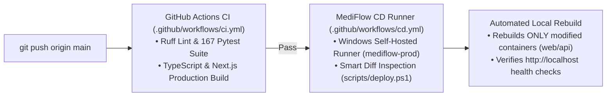

# MEDIFLOW — Agentic Health Management Platform

> **Your health history, in one connected timeline.**  
> A privacy-first, local-first, AI-powered longitudinal personal healthcare management platform.

[](https://github.com/astik77/MediFlow-agentic-health-management-platform/releases/tag/v2.0.0)
[](https://github.com/astik77/MediFlow-agentic-health-management-platform/actions/workflows/ci.yml)
[](docs/quality/reports/TEST_REPORT_010_2026-11-18.txt)
[](docs/quality/reports/BASELINE_STATUS.txt)
[](https://www.python.org/)
[](https://fastapi.tiangolo.com/)
[](https://nextjs.org/)
[](https://github.com/pgvector/pgvector)
[](https://ollama.com/)
[](https://ai.google.dev/)
[](docs/deployment/self-hosted-guide.md)
[](LICENSE)

---

## ⚡ Quick Start: One-Click Execution (Windows)

The entire production stack (**Caddy reverse proxy + Next.js frontend + FastAPI backend + PostgreSQL 16 `pgvector` + Ollama bridge**) can be started with a single click:

1. **Launch Everything:** Double-click [`Start-MEDIFLOW.bat`](Start-MEDIFLOW.bat) in the repository root.
   - Automatically checks & launches **Docker Desktop** and **Ollama** if they are not already running.
   - Starts all production containers and ensures database connectivity.
   - Automatically opens **`http://localhost`** in your default browser.
2. **Stop Anytime:** Double-click [`Stop-MEDIFLOW.bat`](Stop-MEDIFLOW.bat) to stop containers and free system memory (all database records and uploaded documents are preserved).

*(Tip: Right-click `Start-MEDIFLOW.bat` → **Send to → Desktop (create shortcut)** for an instant desktop launcher.)*

---

## 1. Project Vision & Core Capabilities

MEDIFLOW consolidates fragmented personal medical records — laboratory blood panels, prescriptions, discharge summaries, imaging reports, and patient-reported symptoms — into a structured, chronological, patient-owned health vault.

Unlike generic health chatbots or third-party cloud apps, MEDIFLOW is engineered around strict clinical governance and privacy guarantees:

- **Verified Clinical Provenance**: Preserves original raw values, normalized numeric values, units, reference ranges, source document page numbers, and an immutable correction history (`SEC-018`).
- **Patient-in-the-Loop Governance**: OCR-extracted observations remain `candidate` and AI-suggested symptoms remain `pending` until explicitly confirmed, edited, or rejected by the patient — unconfirmed records never contaminate trend charts or KPI totals.
- **Zero-Leakage Patient-Specific Hybrid RAG**: Combines Okapi BM25 lexical search with dense vector similarity (`nomic-embed-text`) via Reciprocal Rank Fusion ($RRF$, $k=60$) strictly scoped by authenticated `patient_id` (`SEC-003` / `RAG-008 = 0.00`).
- **Deterministic Clinical Safety**: Strictly informational; refuses diagnosis, prescribing, and dosage-change requests while deterministically escalating emergency red-flag symptoms (`AIR-004 = 100%`).
- **Hybrid Local & Cloud AI Architecture**: Local-first private inference via Ollama (`qwen2.5:1.5b` + `nomic-embed-text`) with zero cloud data transmission by default, with seamless optional integration with Google Gemini (`gemini-3.1-flash-lite`) for lightning-fast clinical document summarization, longitudinal summaries, and conversational health guidance.
- **Conversational Health Assistant**: Handles broad clinical medical inquiries with conversational warmth while strictly citing verified patient records. Features interactive symptom severity selection (`mild` / `moderate` / `severe`) before persisting to history, and smart chat session auto-naming.
- **Interactive Longitudinal Dashboard**: Longitudinal Health Summaries positioned prominently above biomarker curves, featuring interactive KPI drawers for confirmed observations, active conditions & allergies, and ongoing symptoms contextualized with Gemini-assisted clinical insights.
- **Granular Timeline Management**: Individual event deletion with confirmation modal, and sanitized clinical views free of internal technical UUIDs and raw database metadata.
- **Patient Data Sovereignty**: Full portable JSON health vault export (`GET /api/v1/patients/export`) and password-verified cascading account & physical disk erasure (`DELETE /api/v1/patients/account`).
- **Elevated Public UX**: Modern, approachable landing page (`/`), plain-language capability guide (`/features`), self-hosted privacy policy (`/privacy`), and prominent emergency medical notice (`/disclaimer`).

📖 **Read the complete academic & engineering report:** [`docs/architecture/MASTER_ARCHITECTURE_AND_EVALUATION_REPORT.md`](docs/architecture/MASTER_ARCHITECTURE_AND_EVALUATION_REPORT.md)

---

## 2. Measured Quality & Security Benchmarks (`v2.1.0`)

| Evaluation Area | Measured Result | Target / Gate | Status |
|---|---|---|---|
| **Automated Backend Suite** | **168/168 passed (100%, 0 warnings)** | 100% pass | ✅ PASS |
| **Security Controls (`SEC-001`–`SEC-018`)** | **18/18 verified** | 18/18 controls | ✅ PASS |
| **Document OCR (`DS-LAB/PRES/DISC/IMG`)** | **CER 0.36%, WER 4.17%, Completeness 100%** | CER < 5%, WER < 10% | ✅ PASS |
| **Classification & Numeric Extraction** | **100.0%** across all 12 synthetic docs | > 90% | ✅ PASS |
| **Clinical Safety Triage (`DS-SAFE-001`)** | **100.0% (30/30, 0 unsafe passes)** | 100% | ✅ PASS |
| **Hybrid RAG Retrieval (`DS-RAG-001/002`)** | **Recall@5 100%, Precision@1 100%, MRR 1.00** | Recall@5 > 80% | ✅ PASS |
| **Cross-Patient RAG Leakage (`RAG-008`)** | **0.00 (0 leaks / 20 adversarial queries)** | 0.00 (zero tolerance) | ✅ PASS |
| **Frontend Build (`tsc` + `eslint` + `next build`)** | **0 errors, 0 warnings, 18/18 static + dynamic routes built** | 0 errors | ✅ PASS |

Full quality reports and audit trails are tracked in [`docs/quality/`](docs/quality/reports/BASELINE_STATUS.txt).

---

## 3. Automated CI/CD & Continuous Deployment

MEDIFLOW features an end-to-end continuous integration and deployment pipeline:



- **Continuous Integration ([ci.yml](.github/workflows/ci.yml)):** Runs backend `ruff` lint, unit and integration `pytest` suites against PostgreSQL 16 + `pgvector`, and frontend `pnpm type-check`, `pnpm lint`, and `pnpm build`.
- **Self-Hosted Continuous Deployment ([cd.yml](.github/workflows/cd.yml)):** Runs on your local machine using the Windows runner (`mediflow-laptop`), automatically pulling `main` and running [`scripts/deploy.ps1`](scripts/deploy.ps1) to rebuild only changed containers.
- See the setup guide in [`docs/CICD_SETUP.md`](docs/CICD_SETUP.md).

---

## 4. Monorepo Structure

```
MediFlow-agentic-health-management-platform/
├── Start-MEDIFLOW.bat                # 1-Click launcher (checks Docker, Ollama, starts containers & browser)
├── Stop-MEDIFLOW.bat                 # 1-Click shutdown (stops containers, preserves all data)
├── docker-compose.prod.yaml          # Production stack (Caddy + Web + API + Postgres + Ollama)
├── docker-compose.yaml               # Local dev PostgreSQL 16 + pgvector container
├── .env.example                      # Local development environment template
├── .env.prod.example                 # Self-hosted production environment template
├── scripts/
│   ├── start-mediflow.ps1            # Automated dependency checker and health verifier
│   └── deploy.ps1                    # Smart git-diff container rebuild and health check script
├── apps/
│   ├── web/                          # Next.js 15 App Router Frontend (TypeScript + Tailwind + Recharts)
│   │   ├── src/
│   │   │   ├── app/                  # Routes: /, /features, /privacy, /disclaimer, /dashboard,
│   │   │   │                         #         /health, /documents, /timeline, /assistant, /profile
│   │   │   ├── components/layout/    # Navbar, PublicFooter, responsive headers
│   │   │   ├── features/             # Auth Context & Domain Query Hooks
│   │   │   └── lib/                  # Typed API Clients & Utilities
│   │   ├── Dockerfile                # Multi-stage standalone production build
│   │   └── package.json
│   │
│   └── api/                          # FastAPI Modular Monolith Backend (Python 3.11 + SQLAlchemy 2.0)
│       ├── mediflow/
│       │   ├── api/v1/routers/       # REST Routers (auth, patients, health_records, documents, ai, analytics)
│       │   ├── core/                 # Config, Async DB Engine, Security Headers Middleware, Logging
│       │   ├── models/               # 19 SQLAlchemy ORM Relational Entities
│       │   ├── schemas/              # Pydantic v2 Input/Output Validation Contracts
│       │   ├── services/             # Business Logic, OCR Pipeline, RAG Engine, Safety Filters
│       │   └── main.py               # FastAPI App Factory & Lifespan
│       ├── migrations/               # Alembic Async Migrations (0001–0009, 19 tables)
│       ├── tests/                    # Pytest Suite (167 Unit, API & Security SEC-001–018 tests)
│       ├── scripts/                  # Synthetic Evaluation Harnesses (OCR, Safety, RAG)
│       ├── Dockerfile                # Hardened non-root production image + auto-migrations
│       └── pyproject.toml
│
├── infra/
│   └── docker/
│       ├── postgres/init.sql         # pgvector & uuid-ossp initialization
│       └── caddy/Caddyfile           # Same-origin reverse proxy + automatic Let's Encrypt HTTPS
├── docs/
│   ├── architecture/                 # Architecture Specs & Master System Evaluation Report
│   ├── deployment/                   # Self-Hosted Production Deployment Guide
│   ├── security/                     # Security Model & Threat Matrix (SEC-001–018)
│   ├── quality/                      # Metrics Register, History, Baseline Status & Test Reports
│   └── CICD_SETUP.md                 # Self-hosted GitHub Actions runner setup guide
└── README.md
```

---

## 5. Technology Stack

| Domain | Technology | Rationale |
|---|---|---|
| **Frontend** | Next.js 15 (App Router), TypeScript, Tailwind CSS, Recharts | Accessible, server-rendered React UI with interactive biomarker trend curves |
| **State & Validation** | TanStack Query v5, React Hook Form, Zod | Declarative server-state caching and strict client validation |
| **Backend API** | FastAPI 0.163, Python 3.11, Pydantic v2, structlog | High-performance async REST API with schema enforcement and secret redaction |
| **Database & Vector** | PostgreSQL 16, `pgvector`, SQLAlchemy 2.0 (asyncio), Alembic | Unified relational + vector store with 19 tables across 9 versioned migrations |
| **Document OCR & Parsing** | PyMuPDF (`pymupdf`), Pillow, OpenCV, RapidOCR ONNX | Zero-OS-binary, CPU-friendly digital PDF & scanned report extraction |
| **Hybrid AI & RAG** | Ollama (`qwen2.5:1.5b` + `nomic-embed-text`), Google Gemini (`gemini-3.1-flash-lite`), BM25 + RRF | Local-first private inference + cloud Gemini option with automatic retry fallback and zero thinking budget latency |
| **Gateway & Security** | Caddy 2 (auto-HTTPS), ASGI Security Middleware | Single-port gateway, same-origin `/api/*` proxy, and strict security headers |
| **Automation** | GitHub Actions, Windows Self-Hosted Runner, PowerShell | Continuous integration and zero-friction smart production deployments |

---

## 6. Alternative Setup Methods

### Method A: Docker Compose CLI
```bash
# 1. Copy production env template and configure secrets
cp .env.prod.example .env.prod

# 2. Launch production stack
docker compose -f docker-compose.prod.yaml --env-file .env.prod up -d --build
```
Access the application at **`http://localhost`**.

### Method B: Local Developer Mode (Hot-Reloading)
```bash
# 1. Start PostgreSQL 16 + pgvector container
cp .env.example .env
docker compose up -d

# 2. Backend API (Terminal 1)
cd apps/api
uv sync
uv run alembic upgrade head
uv run uvicorn mediflow.main:app --reload --port 8000

# 3. Frontend Application (Terminal 2)
cd apps/web
pnpm install
pnpm dev
```
- **Web App:** `http://localhost:3000`
- **Swagger API Documentation:** `http://localhost:8000/docs`
- **Run Full Test Suite:** `cd apps/api && uv run pytest -v`

---

## 7. Development Roadmap & Completed Milestones

- [x] **Phase 0: Workspace Foundation & Architecture** (FastAPI + Next.js scaffolding, async DB engine, 25/25 tests).
- [x] **Phase 1: Authentication & Patient Isolation** (Argon2id, HttpOnly sessions, `SEC-001/002/004/005/006`, 50/50 tests).
- [x] **Phase 2: Medical History & Chronological Timeline** (Conditions, allergies, observations, immutable revisions, timeline API, 75/75 tests).
- [x] **Phase 3: Secure Document Vault** (Magic byte check, path traversal prevention, SHA-256 deduplication, 91/91 tests).
- [x] **Phase 4: Document Intelligence & OCR** (RapidOCR ONNX, PyMuPDF, candidate review UI, CER 0.36%, WER 4.17%, 113/113 tests).
- [x] **Phase 5: Local AI Infrastructure** (Ollama provider, Prompt Registry, structured output validation, AI Status UI, 131/131 tests).
- [x] **Phase 6: Conversational AI Health Assistant** (Deterministic clinical safety guardrails, `AIR-004 = 100%`, allowlisted tools, 143/143 tests).
- [x] **Phase 7: Patient-Specific Hybrid RAG** (pgvector cosine + BM25 RRF, zero cross-patient leakage `RAG-008 = 0.00`, 150/150 tests).
- [x] **Phase 8: Dashboard Analytics & Biomarker Trends** (Recharts trend charts with normal reference bands, 7-day health summaries, 162/162 tests).
- [x] **Phase 9: Security Hardening & Data Portability** (Security headers, JSON health vault export, cascading account deletion, 167/167 tests).
- [x] **v2.1 Feature Upgrades & Clinical Refinements** (168/168 tests):
  - **Google Gemini Integration**: Configured `gemini-3.1-flash-lite` with zero thinking-budget overhead and automated graceful fallback resilience for chat and document summaries.
  - **Conversational Health Assistant**: Broadened clinical guidance beyond patient history, added interactive symptom severity toggles (`mild`/`moderate`/`severe`), and smart topic-based chat auto-renaming.
  - **Interactive Health Dashboard**: Moved Longitudinal Health Summaries above biomarker trends; added expandable interactive drawers for confirmed observations, active conditions/allergies, and ongoing symptoms with Gemini synthesis.
  - **Granular Timeline Management**: Individual event deletion with confirmation modal, and sanitized clinical views without raw UUIDs or technical JSON.
- [x] **Production Deployment:** Turnkey self-hosted Docker stack with Caddy, persistent volumes, and Windows Ollama bridge.
- [x] **Landing Page & Public UX Redesign:** Modern two-column hero, interactive product preview, `#how-it-works` workflow, `/features`, `/privacy`, `/disclaimer`.
- [x] **One-Click Automation & CI/CD:** One-click Windows start/stop launchers, GitHub Actions CI with full build gates, and self-hosted CD runner.

---

## 8. License

This project is licensed under the MIT License — see the [LICENSE](LICENSE) file for details.
