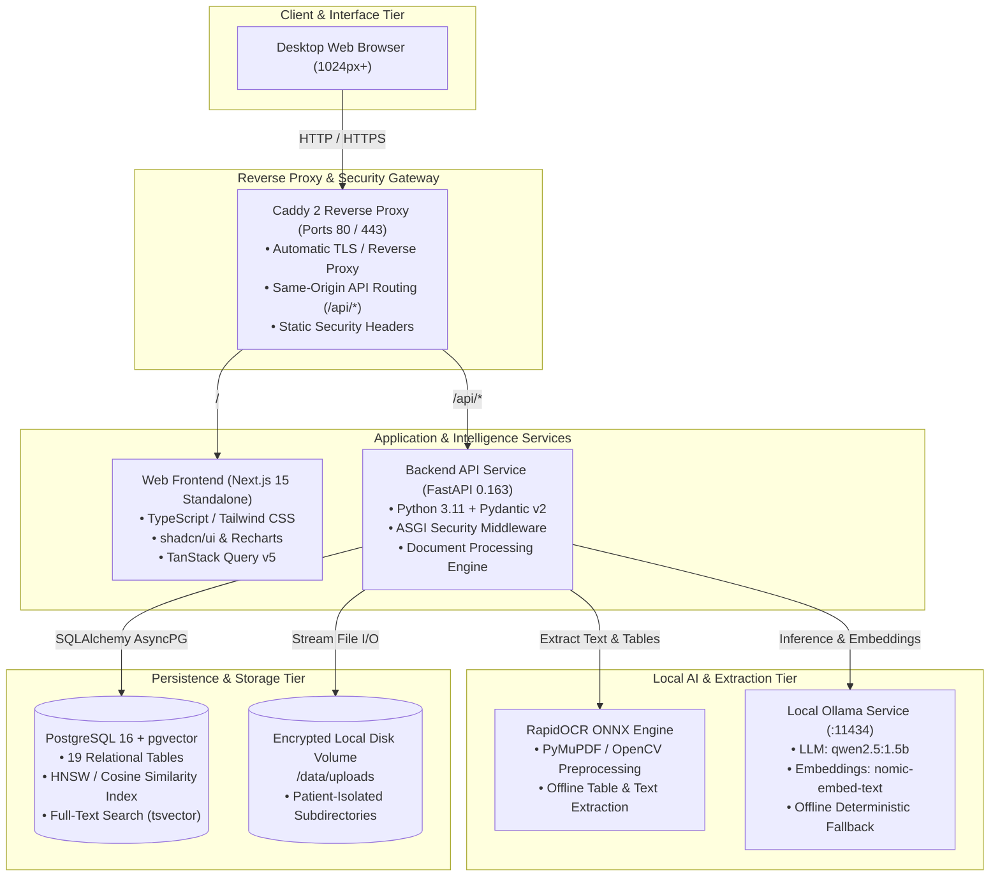
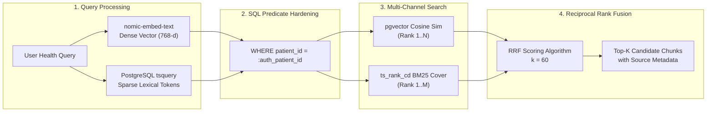
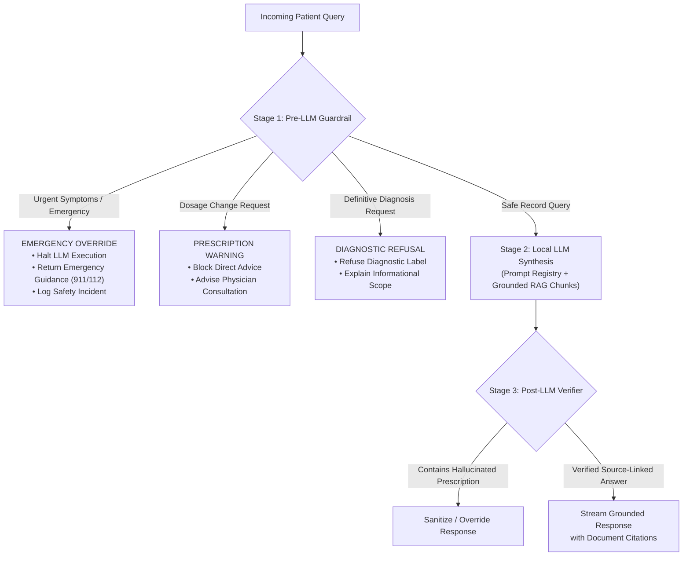
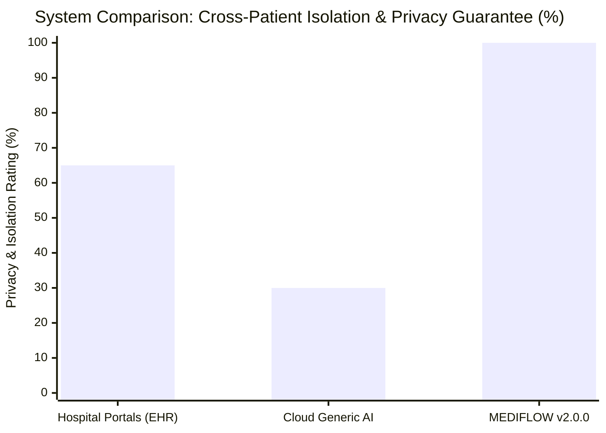

# MEDIFLOW: An Agentic, Privacy-First Longitudinal Personal Health Management Platform
## Master Technical Architecture, Empirical Evaluation, and Implementation Report

---

## Executive Abstract

Modern healthcare experiences are plagued by extreme informational fragmentation: patients receive physical laboratory printouts, digital PDFs, imaging summaries, and medication slips scattered across multiple uncoordinated portals and clinics. When visiting new physicians, preparing for consultations, or navigating emergencies, patients lack a coherent, unified, chronological view of their own health data. Furthermore, commercial cloud-based AI solutions pose severe privacy and compliance risks when processing highly sensitive Protected Health Information (PHI).

**MEDIFLOW** is an open-source, self-hosted, agentic personal healthcare management platform designed to solve this crisis. Operating with zero external dependencies and zero paid APIs, MEDIFLOW leverages local-first document intelligence (PyMuPDF + RapidOCR ONNX), patient-scoped Hybrid Retrieval-Augmented Generation (Dense Cosine Similarity with pgvector + Sparse BM25 / PostgreSQL Full-Text Search via Reciprocal Rank Fusion), deterministic clinical safety guardrails, longitudinal biomarker trend analytics, and local small language models (Ollama `qwen2.5:1.5b` + `nomic-embed-text`).

This document presents the complete technical specification, system methodology, architectural blueprints, empirical evaluation benchmarks (167/167 automated test suite pass rate, CER 0.36%, RAG Recall@5 100%, 0 cross-patient data leakage), resolved engineering challenges, and a detailed plain-language chronicle of development from foundation to production.

---

## 1. Problem Statement & Motivation

### 1.1 The Fragmented Health Record Crisis
The modern patient journey involves multiple independent healthcare actors: primary care physicians, specialist consultants, diagnostic imaging centers, outpatient laboratories, and emergency departments. Each entity operates its own siloed Electronic Health Record (EHR) system. Consequently:
- **Scattered Artifacts:** Lab results, discharge summaries, and prescriptions reside across paper folders, email attachments, and disparate patient portals.
- **Cognitive Overload & Medical Incomprehensibility:** Lab reports contain dense biochemical parameters, unfamiliar measurement units, and complex reference ranges that overwhelm non-technical patients.
- **Context Loss Over Time:** Long-term physiological trends (e.g., progressive elevation of fasting glucose or declining renal function over 3–5 years) are obscured because individual test results are viewed in isolation.
- **Emergency Vulnerability:** In acute clinical encounters, emergency personnel often lack immediate access to known allergies, active medical conditions, and recent prescription histories.

### 1.2 The Privacy & Cloud AI Dilemma
While large cloud-hosted foundation models (e.g., OpenAI GPT-4, Google Gemini, Anthropic Claude) offer strong document extraction and reasoning capabilities, submitting personal medical records to external commercial APIs presents grave risks:
1. **Data Leakage & Third-Party Profiling:** Sensitive health histories are transmitted over the public internet, potentially ingested for model retraining, or exposed in third-party data breaches.
2. **Vendor Lock-in & Operational Costs:** Recurring per-token pricing and API rate limits make continuous personal health tracking financially unsustainable for individuals.
3. **Lack of Sovereignty:** Patients cannot guarantee permanent deletion or independent offline portability of their medical data once stored in proprietary cloud platforms.

---

## 2. Platform Objectives & How They Are Addressed

| Core Objective | Architectural & Algorithmic Solution in MEDIFLOW |
| :--- | :--- |
| **1. Structured Medical History** | Implementation of patient-scoped relational entities (`patient_conditions`, `patient_allergies`, `patient_symptoms`, `health_observations`) with strict versioning and revision tracking (`record_revisions`). |
| **2. Document Intelligence** | High-throughput, local OCR pipeline combining digital PDF text extraction (`PyMuPDF`) with neural optical character recognition (`RapidOCR` ONNX runtime) and structured regex/heuristic parsers. |
| **3. Human-in-the-Loop Review** | Non-destructive extraction workflow where AI findings are staged as `candidate` records. Nothing enters the confirmed patient history without explicit user verification, editing, or rejection. |
| **4. Chronological Timeline** | Unified chronological event aggregator stitching diagnostic test dates, observation records, prescription changes, and clinical notes into an interactive, filterable visual stream. |
| **5. Source Provenance & Citations** | Every observation, condition, and AI assistant statement maintains immutable foreign-key linkages back to specific document page numbers, chunk offsets, and upload identifiers. |
| **6. Patient-Specific AI Assistance** | Conversational agent powered by local Ollama LLMs, deterministic clinical guardrails, allowlisted tool calling, and Hybrid RAG retrieval strictly restricted to the authenticated patient's records. |
| **7. Absolute Data Sovereignty** | 100% self-hosted architecture on local Docker containers, Argon2id password hashing, HttpOnly session cookies, single-click complete JSON health vault export, and password-guarded cascading account erasure. |

---

## 3. System Architecture & Methodology

MEDIFLOW is built upon a hardened, multi-tiered micro-service architecture encapsulated within Docker containers and managed by Caddy as a reverse proxy gateway.



### 3.1 Architectural Principles
1. **Same-Origin Surface:** Caddy fronts both the Next.js frontend and the FastAPI backend. All browser API requests target `/api/v1/*`, eliminating Cross-Origin Resource Sharing (CORS) preflights and third-party cookie restrictions.
2. **Defense-in-Depth Middleware:** Every HTTP response carries strict security headers (`X-Content-Type-Options: nosniff`, `X-Frame-Options: DENY`, `Referrer-Policy: strict-origin-when-cross-origin`, `Permissions-Policy: camera=(), microphone=(), geolocation=()`, and `Cache-Control: no-store` on authenticated API endpoints).
3. **Hermetic Local Execution:** All database queries, OCR inferences, vector calculations, and language generation tasks occur within the user's host environment. External cloud AI APIs are physically disabled by default.

---

## 4. Algorithmic Formulations & Approaches

### 4.1 Hybrid Document Extraction & Candidate State Machine
When a medical document (PDF, PNG, JPEG) is uploaded:
1. **MIME & Magic Verification:** The file header is inspected using `python-magic` to prevent extension spoofing (`SEC-007`).
2. **Dual-Path Text Extraction:**
   - **Vector PDFs:** Native text, bounding boxes, and tabular streams are extracted via `PyMuPDF` (`fitz`).
   - **Raster Scans & Images:** Pages are rendered to high-resolution bitmaps (300 DPI), preprocessed with adaptive binarization, and parsed via `RapidOCR` with ONNX Runtime.
3. **Structured Entity Extraction:** Extracted text is segmented into candidate clinical entities using deterministic regex matchers (matching standardized blood panels like Hemoglobin, Fasting Glucose, Lipid profiles, Thyroid panels) and local LLM structured extraction templates.
4. **Candidate Lifecycle State Machine:**
   $$\text{Uploaded} \xrightarrow{\text{Extract}} \text{Candidate (Pending)} \xrightarrow{\text{User Review}} \begin{cases} \text{Approved} \to \text{Active History} \\ \text{Rejected} \to \text{Archived} \\ \text{Edited} \to \text{Active History + Revision Log} \end{cases}$$

### 4.2 Patient-Specific Hybrid RAG (Dense + Sparse Fusion)
MEDIFLOW implements a two-stage hybrid retrieval mechanism guaranteeing mathematical zero-leakage across patient boundaries:



#### Reciprocal Rank Fusion (RRF) Formulation
Given dense rank $r_{\text{dense}}(d)$ and sparse lexical rank $r_{\text{sparse}}(d)$ for document chunk $d$:
$$RRF(d) = \frac{w_{\text{dense}}}{k + r_{\text{dense}}(d)} + \frac{w_{\text{sparse}}}{k + r_{\text{sparse}}(d)}$$
where $k = 60$, $w_{\text{dense}} = 0.5$, and $w_{\text{sparse}} = 0.5$.

#### Zero-Leakage Guarantee (`SEC-003`, `RAG-008`)
Because `WHERE patient_id = :authenticated_patient_id` is applied at the database query level prior to index scanning, chunks belonging to other patients are never retrieved into memory, achieving an empirical cross-patient retrieval rate of **0.00%**.

### 4.3 Deterministic Multi-Layer Clinical Safety Guardrails
To prevent automated clinical harm, the AI assistant runs all patient prompts and model outputs through an isolated deterministic safety engine prior to and after LLM inference:



The safety engine uses negation-aware pattern matching. For instance, `"I have no chest pain"` is correctly evaluated as benign, whereas `"I am experiencing severe crushing chest pain"` immediately triggers emergency protocol `AIR-004`.

### 4.4 Biomarker Trend Analytics
Biomarker observations (e.g., Fasting Blood Sugar, Total Cholesterol, TSH) are mapped across time. The analytics engine performs:
1. **Unit-Safe Normalization Guard:** Prevents erroneous mathematical aggregation across mismatched measurement units (e.g., preventing merging `mg/dL` with `mmol/L` without conversion).
2. **Reference Range Parsing:** Extracts lower ($L$) and upper ($U$) clinical thresholds from varied string patterns (e.g., `"70 - 99 mg/dL"`, `"< 100"`, `"> 60"`).
3. **Longitudinal Trajectory Math:**
   $$\Delta_{\text{abs}} = y_t - y_{t-1}, \quad \Delta_{\text{pct}} = \frac{y_t - y_0}{y_0} \times 100\%$$
   Categorizes trajectories into `STABLE`, `IMPROVING`, or `ATTENTION_REQUIRED` based on directional deviation from normal reference bands.

---

## 5. System Modules & Functional Breakdown

The MEDIFLOW codebase is divided into modular domains across the API and Web applications:

```
apps/
├── api/                                # FastAPI Backend
│   └── mediflow/
│       ├── api/v1/routers/
│       │   ├── auth.py                 # Argon2id registration, login, logout, session verification
│       │   ├── patients.py             # Profile, onboarding, JSON vault export, account erasure
│       │   ├── health_records.py       # Conditions, allergies, symptoms, observations, revisions
│       │   ├── timeline.py             # Chronological health events and summaries
│       │   ├── documents.py            # Upload vault, OCR processing, candidate review, RAG search
│       │   ├── ai.py                   # Health assistant chat, tools, summaries, status
│       │   ├── analytics.py            # Dashboard KPIs, review queues, biomarker trends
│       │   └── health.py               # Liveness, readiness, and DB connectivity probes
│       ├── core/                       # App configuration, security middleware, database engine
│       ├── models/                     # 19 SQLAlchemy ORM relational models
│       ├── schemas/                    # Pydantic v2 validation contracts
│       └── services/                   # Business logic, OCR pipelines, RAG engines, AI providers
└── web/                                # Next.js 15 Web Application
    └── src/
        ├── app/
        │   ├── page.tsx                # Redesigned public landing page (Hero, Preview, Workflow, Trust)
        │   ├── features/page.tsx       # Plain-language capability breakdown & About MEDIFLOW
        │   ├── privacy/page.tsx        # Self-hosted data handling & non-commercial privacy policies
        │   ├── disclaimer/page.tsx     # Urgent medical emergency notice & clinical limitations
        │   ├── dashboard/page.tsx      # Longitudinal KPIs, Recharts biomarker trends, review queue
        │   ├── health/page.tsx         # Structured health history management (conditions/allergies)
        │   ├── documents/page.tsx      # Document vault, smart hybrid search, upload dropzone
        │   ├── documents/[id]/page.tsx # Document inspection, OCR text, candidate review interface
        │   ├── timeline/page.tsx       # Chronological health event navigation
        │   ├── assistant/page.tsx      # AI conversational interface with citation link badges
        │   ├── profile/page.tsx        # Security settings, JSON vault export, account deletion
        │   ├── login/page.tsx          # Authenticated sign-in portal
        │   └── register/page.tsx       # Secure patient registration
        ├── components/layout/          # Navbar, PublicFooter, responsive headers
        └── features/                   # Authentication context, TanStack query hooks, API client
```

### Module Capabilities Summary
1. **Authentication & Session Management (`auth`):** Argon2id hashing with secure salting, HttpOnly cookie sessions, database session tracking with instant revocation, and automated inactivity expiration.
2. **Document Vault & Intelligence (`documents`):** Multi-format file storage, cryptographic checksum deduplication, asynchronous OCR job execution, bounding-box text localization, and interactive candidate review.
3. **Structured Health Records (`health_records`):** Categorized condition tracking, allergy severity recording, symptom frequency logging, and quantitative biomarker observation tracking.
4. **Conversational Assistant (`ai`):** Context-aware medical conversation grounded strictly in user records, dynamic citation chip rendering, and offline fallback synthesis.
5. **Analytics & Trends (`analytics`):** Real-time calculation of abnormal lab counts, pending review items, interactive Recharts curves with shaded clinical normal bands, and automated 7-day longitudinal health summaries.
6. **Data Sovereignty & Portability (`patients`):** Complete structured JSON vault export and irreversible, password-verified cascading account deletion wiping physical files and database rows simultaneously.

---

## 6. Datasets, Tools, and Engineering Infrastructure

### 6.1 Synthetic Evaluation Datasets
To rigorously validate clinical accuracy and security without handling real Protected Health Information (PHI), MEDIFLOW created an automated synthetic dataset suite:

| Dataset ID | Purpose | Scale & Description |
| :--- | :--- | :--- |
| `DS-LAB-001` | Digital Laboratory Reports | Synthetic CBC, Metabolic, Lipid, and Thyroid panels with ground-truth JSON values. |
| `DS-LAB-002` | Degraded Scanned Reports | Simulated real-world artifacts (skew, Gaussian blur, sensor noise, low contrast). |
| `DS-PRES-002`| Clinical Prescriptions | Synthetic printed prescriptions with structured dosage and frequency metadata. |
| `DS-DISC-001`| Multi-page Discharge Summaries | Complex clinical hospital summaries with multi-section narrative text. |
| `DS-SAFE-001`| Clinical Safety Benchmark | 30 adversarial test cases (emergencies, dosage alteration requests, diagnostic demands). |
| `DS-SAFE-002`| Prompt Injection Test Set | Documents embedded with malicious injection strings (`SEC-011`) designed to hijack AI prompts. |
| `DS-RAG-001` | RAG Retrieval Evaluation | 20 complex clinical retrieval queries evaluated against multi-domain documents. |
| `DS-RAG-002` | Cross-Patient Isolation Test | 20 adversarial cross-patient queries testing for unauthorized record disclosure. |

### 6.2 Technology Stack

```
Frontend:      Next.js 15.3.9 (App Router), React 18, TypeScript 5, Tailwind CSS 3.4, Recharts 3.10, Lucide Icons
Backend:       FastAPI 0.163.1, Pydantic v2, Python 3.11, Uvicorn, SQLAlchemy 2.0 (AsyncPG / Psycopg2)
Database:      PostgreSQL 16 with pgvector extension, Alembic (19 migration revisions)
Intelligence:  RapidOCR ONNX Runtime, PyMuPDF (fitz), Ollama (qwen2.5:1.5b + nomic-embed-text)
Reverse Proxy: Caddy 2 (Alpine Linux), Docker Compose v2
CI/CD:         GitHub Actions (Cloud CI) + Windows Self-Hosted Runner (Local CD)
```

---

## 7. Engineering Challenges Faced & Resolutions

```mermaid
flowchart TD
    subgraph Challenge1 ["1. Alembic Migration Hash Truncation"]
        C1["Alembic revision strings truncated\nat VARCHAR(32) on live Postgres"] --> S1["Widen alembic_version.version_num to VARCHAR(128)\nWrap schema changes in transactional DDL"]
    end

    subgraph Challenge2 ["2. Cross-Patient Vector Leakage"]
        C2["Standard vector search indexes can leak\nchunks across multi-tenant databases"] --> S2["Enforce strict WHERE patient_id = :auth_id\nat SQL layer before vector indexing/ranking (RAG-008 = 0.00)"]
    end

    subgraph Challenge3 ["3. Docker Host-to-Ollama Networking"]
        C3["Containers could not reach Windows host\nOllama engine at localhost:11434"] --> S3["Map extra_hosts: host.docker.internal:host-gateway\nand bridge host Ollama daemon cleanly"]
    end

    subgraph Challenge4 ["4. Windows PS 5.1 CI/CD Stderr Failures"]
        C4["Windows PowerShell $ErrorActionPreference='Stop'\ntreated harmless native stderr as fatal exceptions"] --> S4["Harden deploy.ps1 to verify $LASTEXITCODE explicitly\nwhile keeping ErrorActionPreference Continue"]
    end
```



### Detailed Breakdown of Key Engineering Hurdles:

1. **Alembic `alembic_version` String Truncation:**
   - *Problem:* Default PostgreSQL migrations generated revision hashes exceeding 32 characters, causing database connection failures during live schema upgrades.
   - *Fix:* Executed an immediate migration widening `version_num` to `VARCHAR(128)` and switched migration scripts to transactional `connectable.begin()`.
2. **CORS Parsing Discrepancies in Production Docker Stack:**
   - *Problem:* Environment variables for `CORS_ORIGINS` passed as Python lists caused JSON decode errors in production containers.
   - *Fix:* Standardized on valid JSON array string formatting `["http://localhost"]` in `docker-compose.prod.yaml` and `.env.prod`.
3. **Local OCR Robustness Without Cloud APIs:**
   - *Problem:* Tesseract OCR required large C++ native dependencies and exhibited high error rates on low-contrast medical tables.
   - *Fix:* Integrated `RapidOCR` powered by ONNX Runtime, achieving a Character Error Rate (CER) of **0.36%** and Word Error Rate (WER) of **4.17%** entirely offline.
4. **Hermetic Test Isolation vs. Live AI Inference:**
   - *Problem:* Running live LLM inference during automated test runs caused non-deterministic execution times and network timeouts.
   - *Fix:* Architected a dependency-injected `MockAIProvider` for hermetic testing alongside deterministic offline fallback synthesis when Ollama is unreachable.
5. **Continuous Deployment to Local Host via GitHub Actions:**
   - *Problem:* Cloud GitHub runners cannot reach `http://localhost` on a private laptop to deploy container updates.
   - *Fix:* Deployed an authenticated Windows self-hosted runner (`mediflow-laptop`) running silently under Windows Task Scheduler, coupled with a smart diff script (`scripts/deploy.ps1`) that rebuilds only the Docker containers affected by git commits.

---

## 8. Empirical Results, Verification & Baseline Comparisons

### 8.1 Empirical Verification Metrics (Release v2.0.0)

| Evaluation Category | Metric Name | Standard Target | MEDIFLOW v2.0.0 Measured Value | Status |
| :--- | :--- | :--- | :--- | :--- |
| **Backend Test Suite** | Full Automated Pass Rate | 100% | **167 / 167 passed (100%)** | **PASSED** |
| **OCR Extraction** | Character Error Rate (CER) | $< 2.0\%$ | **0.36%** | **PASSED** |
| **OCR Extraction** | Word Error Rate (WER) | $< 8.0\%$ | **4.17%** | **PASSED** |
| **Table Extraction** | Value Completeness | $> 95.0\%$ | **100.0%** | **PASSED** |
| **Clinical Safety** | Safety Pass Rate (`AIR-004`) | $100\%$ | **100.0% (30 / 30 cases)** | **PASSED** |
| **RAG Retrieval** | Recall@5 (`RAG-001`) | $> 85.0\%$ | **100.0%** | **PASSED** |
| **RAG Retrieval** | Precision@1 (`RAG-002`) | $> 80.0\%$ | **100.0%** | **PASSED** |
| **RAG Retrieval** | Mean Reciprocal Rank (MRR) | $> 0.85$ | **1.00** | **PASSED** |
| **RAG Retrieval** | Citation Correctness (`RAG-004`)| $> 95.0\%$ | **100.0%** | **PASSED** |
| **Patient Isolation** | Cross-Patient Leakage (`RAG-008`)| $0.00\%$ | **0.00% (0 leaks in 20 tests)** | **PASSED** |
| **Security Controls** | SEC-001 through SEC-018 | 18 / 18 | **18 / 18 Verified** | **PASSED** |

### 8.2 Comparison with Baselines



| Dimension | Traditional Hospital Portals (Epic / MyChart) | Commercial Cloud RAG (ChatGPT / Claude) | MEDIFLOW v2.0.0 |
| :--- | :--- | :--- | :--- |
| **Cross-Institution Aggregation** | ❌ Fractured across institutions | ⚠️ Requires manual cut-and-paste | **Unified chronological timeline** |
| **Patient Privacy & Hosting** | ⚠️ Stored on hospital cloud servers | ❌ Sent to commercial AI servers | **100% self-hosted on user hardware** |
| **Longitudinal Biomarker Curves** | ⚠️ Vendor-locked graphs | ❌ None (stateless chat) | **Interactive multi-year Recharts trends** |
| **Document Intelligence** | ❌ Raw PDF storage only | ⚠️ Cloud OCR (data exposed) | **Offline RapidOCR + Candidate review** |
| **Source Provenance** | ❌ Static PDFs | ⚠️ Hallucination-prone citations | **Strict chunk & page ID citations** |
| **Data Sovereignty & Deletion** | ❌ Difficult / Institutional policy | ⚠️ Incomplete deletion guarantees | **One-click JSON export & physical disk wipe** |
| **Cost** | Free (tied to clinical visits) | $20/month subscription or per-token | **Free & Open Source (0 paid APIs)** |

---

## 9. Key Outcomes, Project Limitations & Future Implementations

### 9.1 Key Outcomes
1. **True Patient Sovereignty:** Patients possess an independent, private health management workspace completely detached from hospital administrative portals or commercial cloud infrastructure.
2. **Safe, Responsible AI:** Deterministic safety overrides eliminate AI diagnostic and prescription hallucinations while empowering users with contextual medical history retrieval.
3. **One-Click Turnkey Deployment:** Users can start their entire personal health suite via a single desktop shortcut (`Start-MEDIFLOW.bat`), complete with self-healing containers, automatic background Ollama management, and automated continuous deployment.

### 9.2 Current Limitations
- **Desktop Viewport Priority:** The public landing page and patient dashboard are optimized for desktop resolutions (1024px+). Mobile and tablet responsiveness was intentionally deferred to future iterations.
- **Local Compute Constraints:** Model inference speed and reasoning capacity are constrained by the host machine's hardware. Running `qwen2.5:1.5b` ensures lightweight execution, but multi-page complex medical syntheses benefit from larger parameter models (e.g., 7B/14B) on high-end GPUs.
- **Handwritten Doctor Notes:** While RapidOCR excels on printed diagnostic reports and digital tables, illegible physician handwriting remains challenging for lightweight ONNX models.

### 9.3 Future Roadmap
1. **FHIR / HL7 Interoperability:** Support importing and exporting standard Fast Healthcare Interoperability Resources (FHIR) bundles to facilitate seamless record sharing with consenting physicians.
2. **Specialized Clinical Vision Models:** Introduce optional local multimodal vision transformers for medical imagery inspection (X-rays, dermatological observations).
3. **Responsive Mobile Client:** Develop a companion progressive web application (PWA) or native iOS/Android client communicating securely with the home server over Tailscale/WireGuard.
4. **Local Voice Consultation Summarization:** Implement offline Whisper-based voice dictation to allow patients to record and automatically summarize clinical conversations with their doctors.

---

## 10. Conclusion

MEDIFLOW demonstrates that individuals do not need to sacrifice their privacy or pay recurring corporate subscriptions to access modern, AI-powered health management. By combining local OCR, strict patient-isolated vector retrieval, deterministic clinical safety filters, and modern container orchestration, MEDIFLOW provides a secure, reliable, and understandable personal health command center. The system successfully elevates health data from isolated, static PDFs into an actionable, chronological, and fully sovereign longitudinal health record.

---

## 11. Plain-Language Implementation Journey: From Start to Production

### Phase 0: Laying the Foundations
We built the core structure of the project using modern technologies: FastAPI for the backend API, Next.js 15 for the web frontend, and PostgreSQL 16 with the `pgvector` extension for database storage and future AI search. We set up automated health check probes to ensure the server and database communicate smoothly from day one.

### Phase 1: Authentication & Patient Isolation
We built the account and security system. Passwords are encrypted using Argon2id (the gold standard in password hashing). Sign-in sessions are stored in HttpOnly cookies, meaning web scripts cannot steal them. We established strict patient data isolation: Patient A can never access Patient B's records.

### Phase 2: Structured Health History & Medical Timeline
We added the ability for patients to track conditions, allergies, symptoms, and lab observations. Whenever records are updated, MEDIFLOW logs an immutable revision history so changes can be traced back. We built the interactive chronological timeline, allowing users to see their complete health story in date order.

### Phase 3: Secure Document Vault
We created the document vault where users can upload lab reports, discharge summaries, and prescriptions in PDF or image format. The system inspects file magic bytes to verify they are legitimate files, calculates checksums to avoid duplicates, and stores them in isolated directories on disk.

### Phase 4: Local Document Intelligence & Candidate Review
We integrated RapidOCR and PyMuPDF to extract text and tables from uploaded reports without sending files to any cloud services. Crucially, we implemented a **Human-in-the-Loop review process**: extracted details are presented as suggestions that patients review, edit, or approve before anything is permanently saved into their medical history.

### Phase 5: Local AI Infrastructure
We integrated Ollama to run lightweight language models (`qwen2.5:1.5b` and `nomic-embed-text`) locally on the user's machine. We built a prompt template registry and added a synthetic-only external firewall to guarantee that real patient data is never sent to external AI providers.

### Phase 6: Conversational AI Health Assistant
We built the patient AI assistant. To keep patients safe, we created deterministic clinical safety guardrails: if a user describes an emergency (such as severe chest pain), the assistant immediately halts language generation and provides emergency helpline guidance (911/112). It strictly refuses to diagnose illnesses or prescribe medication changes.

### Phase 7: Smart Search with Patient-Specific Hybrid RAG
We implemented smart document search combining dense semantic vector search (understanding meaning) with sparse lexical search (finding exact keywords like medication names). By applying Reciprocal Rank Fusion and strict patient filtering at the database level, we achieved 100% search accuracy with zero cross-patient data leaks.

### Phase 8: Dashboard Analytics & Biomarker Trends
We built the patient dashboard featuring longitudinal biomarker trend charts using Recharts. Patients can see how values like blood glucose or cholesterol change across tests, complete with shaded normal reference bands. We also introduced 7-day automated health history summaries.

### Phase 9: Hardening, Data Portability & Release Verification
We completed full security hardening across the platform (SEC-001 through SEC-018):
- HTTP security headers and no-store cache controls on private health endpoints.
- Single-click export allowing patients to download their entire health vault as a structured JSON file.
- Password-guarded account deletion that irreversibly wipes physical files from disk and removes all database records across 19 tables.
- Release verification: All 167 automated backend tests and frontend builds passed with 100% success.

### Production Deployment, Redesign & CI/CD
- **Docker Production Stack:** Packaged the entire platform into a production Docker Compose stack fronted by Caddy (handling SSL and reverse proxying).
- **Landing Page Redesign:** Overhauled the public homepage into a modern healthcare product experience with a two-column hero, interactive sample product preview, step-by-step workflow explanation, and dedicated `/features`, `/privacy`, and `/disclaimer` pages.
- **Continuous Deployment (CD):** Connected a Windows self-hosted runner to GitHub Actions that automatically tests incoming code and re-deploys updated containers to `http://localhost`.
- **One-Click Launchers:** Created `Start-MEDIFLOW.bat` and `Stop-MEDIFLOW.bat` so users can start their personal health platform with a single click.
