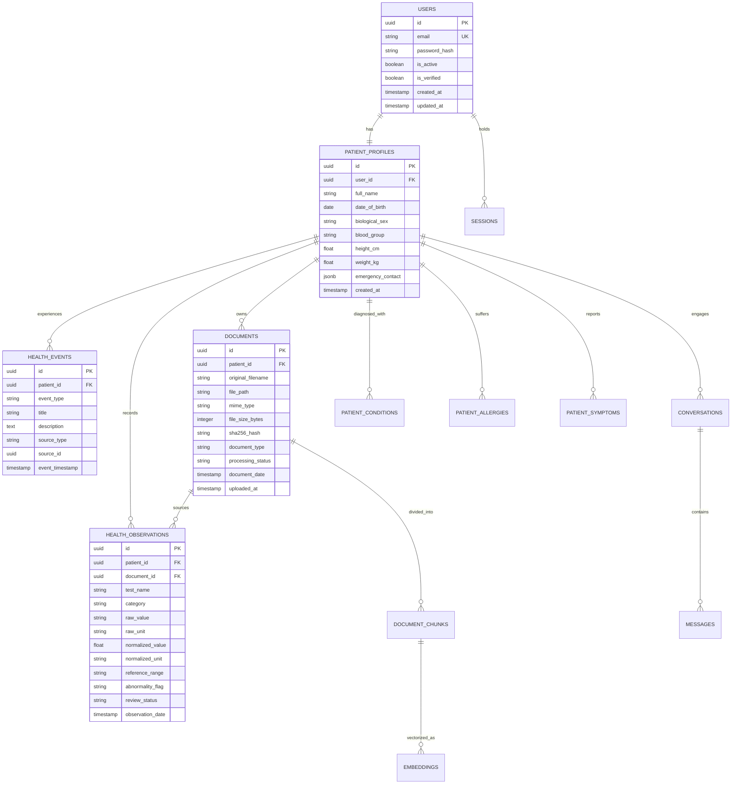

# MEDIFLOW — Database Design Specification

## 1. Principles & Standards
1. **Relational Integrity**: Every patient-owned entity possesses a foreign key relationship to the primary patient profile or user identifier.
2. **Immutable Identifiers**: Primary keys utilize UUIDs (UUIDv7 or UUIDv4) generated server-side or via database defaults. Sequential IDs are never exposed externally.
3. **Auditability & Provenance**: Core clinical observations retain original raw values, normalized values, measurement units, reference ranges, source document IDs, and extraction statuses.
4. **Candidate vs Confirmed**: AI-extracted facts remain in a `candidate` state until explicitly reviewed and confirmed by the patient.

---

## 2. Entity-Relationship Overview

---

## 3. Migration Strategy (Alembic)
- Migrations are managed inside `apps/api/migrations/`.
- `alembic.ini` and `env.py` use an async SQLAlchemy runner connecting to PostgreSQL.
- Database naming conventions ensure clean, deterministic constraint names (`ix_`, `uq_`, `ck_`, `fk_`, `pk_`).
- Destructive schema drops are disallowed in production without explicit review and rollback scripts.
