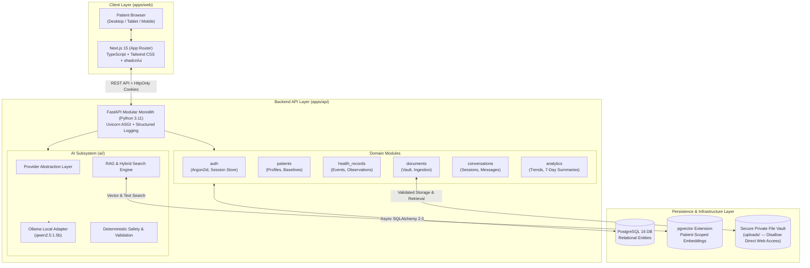

# MEDIFLOW — System Architecture Specification

## 1. Architectural Philosophy
MEDIFLOW uses a **Modular Monolith** architecture. This avoids the operational complexity, network overhead, and distributed failure modes of microservices while providing strict domain isolation, clean modular boundaries, and direct developer velocity.

---

## 2. System Architecture Diagram

---

## 3. Layer Breakdown

### 3.1 Web Frontend (`apps/web`)
- **Technology**: Next.js 15.3 (App Router), React 18, TypeScript, Tailwind CSS, shadcn/ui, TanStack Query v5.
- **Security**: No tokens stored in localStorage. Authentication relies exclusively on server-managed HttpOnly, Secure, SameSite cookies.
- **State Management**: Server State managed via TanStack Query with automatic caching and cache invalidation. Client form state managed via React Hook Form and validated with Zod.

### 3.2 Backend API (`apps/api`)
- **Technology**: FastAPI 0.163, Python 3.11, Pydantic v2, SQLAlchemy 2.0 (asyncio), structlog.
- **Modularity**: Domain modules (`auth`, `patients`, `health_records`, `documents`, `conversations`, `analytics`, `consent`, `audit`) are logically decoupled with clean service boundaries.
- **Rate Limiting**: Integrated SlowAPI limiter protecting sensitive authentication and computational endpoints.

### 3.3 Database & Vector Engine
- **Technology**: PostgreSQL 16 with `pgvector`, `uuid-ossp`, and `pgcrypto`.
- **Hybrid Retrieval**: PostgreSQL full-text search combined with cosine-similarity vector queries via pgvector.
- **Patient Isolation**: All queries must enforce `WHERE patient_id = :authenticated_patient_id` at the service layer, augmented by optional Row-Level Security (RLS) policies.

---

## 4. Hardware Constraints & In-Memory Inference Strategy
The host system is equipped with:
- **CPU**: Intel Core i3-1005G1 (2 cores, 4 threads @ 1.20GHz).
- **RAM**: ~7.7 GB total physical memory.
- **GPU**: Intel UHD Graphics (integrated, 1 GB shared memory).
- **Storage**: ~29 GB available SSD storage.

**Strategic Implications**:
- Large local LLMs (e.g. 7B+ or 14B) cannot run reliably without swapping or out-of-memory crashes.
- Phase 5 local AI architecture prioritizes lightweight, quantized instruction models (`qwen2.5:1.5b` or `phi3.5:3.8b` Q4_K_M).
- RAG embeddings will use compact embedding models (`nomic-embed-text` or `all-MiniLM-L6-v2`).
- External API adapters (Gemini, Grok) remain available as optional experimental alternatives, disabled for real patient data.
