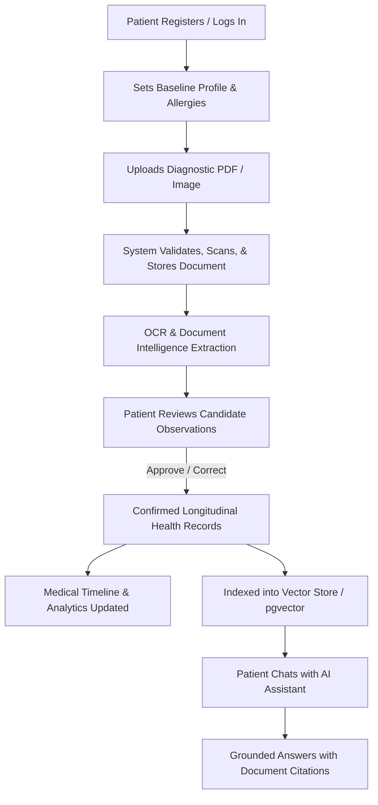

# MEDIFLOW — Product Requirements Document (PRD)

## 1. Document Overview
- **Document Version**: 1.0.0
- **Status**: Approved Foundation
- **Target Launch Scope**: Patient-Only MVP (Phases 0–9)
- **Target Geography**: India (Initial), designed with international localization readiness.

---

## 2. Product Vision & Problem Statement

### 2.1 The Problem
Personal medical records are deeply fragmented across physical prescriptions, disparate diagnostic lab PDFs, hospital discharge summaries, radiology scans, and oral doctor consultations. Patients lack a single, unified, longitudinal view of their health, cannot easily interpret numerical biomarkers over time, and frequently lose crucial medical context when seeking second opinions or managing chronic symptoms.

### 2.2 The Solution
**MEDIFLOW** is an AI-powered longitudinal personal healthcare management platform. It empowers patients to consolidate, structure, understand, and maintain their complete health history through:
- Automated document intelligence and OCR parsing.
- Patient-verified structured observation tracking with reference ranges and chronological trends.
- A grounded, contextual AI Health Assistant using patient-specific Retrieval-Augmented Generation (RAG).
- Seven-day health snapshots, trend visualizations, and timeline exploration.
- Privacy-first data ownership, explicit consent, and robust data isolation.

---

## 3. Product Scope & Guardrails

### 3.1 In-Scope (Patient-Only MVP)
1. **Authentication & Identity**: Secure registration, login, session management, Argon2id password hashing, CSRF and session revocation.
2. **Patient Profile & Baselines**: Demographics, emergency contacts, baseline health metrics, existing conditions, known allergies.
3. **Medical History Management**: Chronological observation tracking, symptom logs, medical event provenance, patient-driven correction workflows.
4. **Secure Document Vault**: Private file storage, MIME/signature verification, malware screening, preview, deletion synchronization.
5. **Document Intelligence**: Automated OCR, table extraction, biomarker parsing (value, unit, reference range, test date, candidate status).
6. **Patient Review Workflow**: AI extractions remain candidates until accepted, edited, or rejected by the patient.
7. **AI Health Assistant**: Conversational agent providing patient-friendly explanations, symptom clarification, and health-event proposals.
8. **Patient-Specific RAG**: PostgreSQL + pgvector hybrid retrieval grounded solely in authenticated patient records.
9. **Timeline & Analytics**: Chronological health events, multi-test longitudinal trends, seven-day activity summaries.
10. **Data Governance & Privacy**: Granular consent preferences, data export, and complete account/record deletion.

### 3.2 Explicit Non-Goals (Out of Scope for MVP)
To maintain architectural discipline and focus, the following are strictly excluded:
- Doctor / Clinic / Hospital / Physiotherapist accounts or provider portals.
- Doctor scheduling, appointment booking, or hospital discovery.
- Electronic Health Record (EHR) integrations or doctor-side prescription writing.
- Insurance claims processing or billing workflows.
- Autonomous medical diagnostic tools or clinical triage decision systems.

---

## 4. Healthcare AI Safety Principles
1. **Informational & Educational Only**: MEDIFLOW does not diagnose, prescribe, alter dosages, or advise discontinuation of prescribed therapies.
2. **Explicit Provenance**: Every observation distinguishes between patient-reported, AI-extracted, and patient-confirmed data.
3. **Emergency Escalation**: When red-flag urgency symptoms are detected, deterministic safety rules direct patients to local emergency services.
4. **No Fabricated History**: The AI assistant never hallucinates patient records; missing records are explicitly stated.
5. **No Synthetic Risk Scores**: No arbitrary composite health scores are generated without validated clinical backing.

---

## 5. User Journeys

---

## 6. Non-Functional Requirements
- **Security & Privacy**: Zero cross-patient leakage (SEC-001–003), encrypted sessions, HttpOnly cookies, zero external AI transmission of real data by default.
- **Performance**: Standard API P95 latency < 500ms; background OCR job processing P95 < 60s.
- **Cost**: 100% free and open-source infrastructure (PostgreSQL, pgvector, Ollama local inference, Next.js, FastAPI).
- **Accessibility**: Compliance with WCAG 2.2 AA standards across desktop, tablet, and mobile breakpoints.
